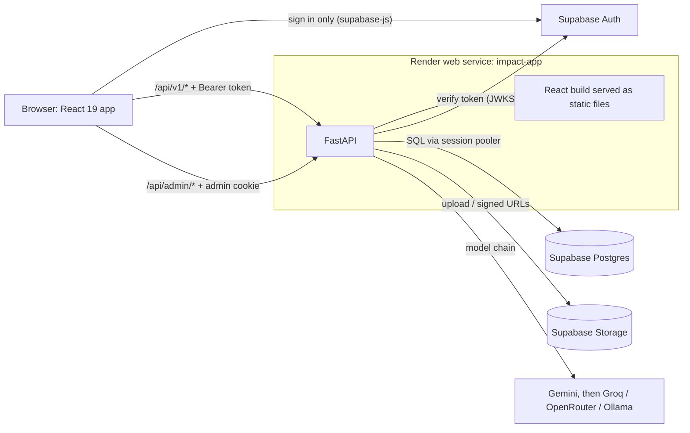
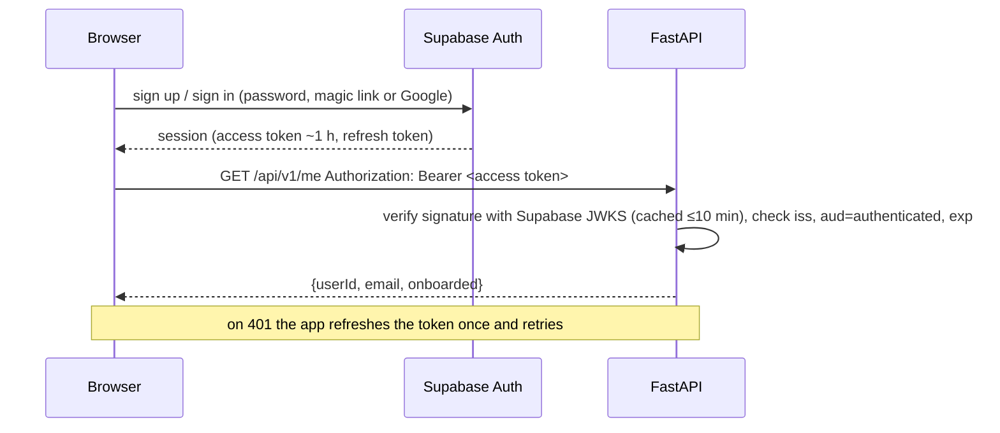

# Architecture

Impact++ is one React app and one FastAPI service, backed by one Supabase project (Postgres, Auth and Storage). It joins five modules that were built separately (see `docs/README.md`).

This file covers:
- how the pieces fit together and how requests flow;
- the module boundary rules;
- the constraints that shape the code.

The data model is in `DATA_MODEL.md`. The shapes passed between modules are in `CONTRACTS.md`. Every product choice and how to switch it is in `DECISIONS.md`.

## 1. System overview



**One service, one address (T-03).** The FastAPI service serves the built React app as well as the API. Pages and API share one origin, which gives three things:
- The admin cookie works. Two `onrender.com` subdomains count as different sites, because `onrender.com` is a public suffix.
- API calls need no CORS preflight.
- Analytics beacons can be sent on page close.

The alternative still works through settings: a separate static site plus `VITE_API_BASE` and `CORS_ORIGINS`.

**Supabase does three jobs.** It is the database, the sign-in service and file storage.
- The browser uses Supabase only to sign in (T-05). Every read and write goes through FastAPI, which enforces the rules in one place.
- Row-level security is on with no policies (T-06), so the database can't be reached through Supabase's public data API at all.

## 2. Backend layout

```
backend/app/
  main.py          create_app(): middleware, routers, static React build with SPA fallback
  config.py        environment settings (pydantic-settings)
  db.py            SQLAlchemy Core engine (psycopg3), transaction helper
  platform/        shared infrastructure, no product logic
    auth.py          Supabase token check → CurrentUser(id, email)
    security.py      signed tokens, client IP, https detection (from the Wish Engine)
    rate_limit.py    in-memory token buckets (from the Wish Engine)
    admin_auth.py    ADMIN_PASSWORD login, signed 12 h cookie (from the Wish Engine)
    http.py          read_json with size caps, 400 {ok:false,error} errors
    storage.py       Supabase Storage: upload, delete, 60 s signed URLs
    bus.py           publish / subscribe, delivered after commit
    jobs.py          background tasks + startup recovery sweep
    events_log/      analytics event batches + page-close tickets
    admin/           admin dashboard, exports, policies editor
  llm/             the Wish Engine's model chain, shared by every module (T-10)
  contracts/       versioned pydantic contracts (CONTRACTS.md)
  policies/        every switchable decision (DECISIONS.md)
  modules/
    profile/ wish/ growth/ social/ feed/
      router.py   HTTP routes for this module
      api.py      the ONLY functions other modules may call; returns contracts
      service.py  business logic
      repo.py     SQL for this module's own tables
      tables.py   SQLAlchemy table definitions for this module's schema
```

### Module boundary rules (T-01)

A module may import:
- `app.contracts`, `app.policies`, `app.platform`, `app.llm` and `app.db`;
- **another module's `api.py` only**, never another module's `service`, `repo` or `tables`.

`app.contracts` imports nothing from `app`. `app.policies` imports only `app.contracts` and `app.platform.config`.

These rules are checked in CI with `import-linter`. Following them means a module owner can rewrite their module's internals without breaking anyone, as long as `api.py` keeps returning the same contract.

### Policies (DECISIONS.md "How switching works")

- `policies/defaults.py` lists every key.
- `policies/loader.py` resolves each key: the default, then an env var, then the admin override in `core.settings`. It caches the result for 30 s.
- Strategy packages (`validation.py`, `scoring/`, `skills.py`, `unlocks.py`, `effort.py`, `flow.py`, `buddy.py`, `notifications.py`) expose one getter each, e.g. `get_validation_strategy()`.

Business code calls the getter and never compares policy strings.

## 3. Request flows

### Sign-in and every API call



**Token check (T-04).**
1. Read the token's `kid`.
2. Verify it against `<SUPABASE_URL>/auth/v1/.well-known/jwks.json` (ES256 or RS256).
3. If the project still uses the legacy shared secret (HS256), verify with `SUPABASE_JWT_SECRET` instead.
4. Check that `iss = <SUPABASE_URL>/auth/v1`, `aud = authenticated`, `exp` is in the future, and `role = authenticated`.
5. The user id is `sub`.

**New users.** A database trigger on `auth.users` creates the `profile.profiles` row, so the API never has to create it on a GET.

### The core loop

1. **Onboarding (profile).** The user optionally uploads a resume:
   - FastAPI checks its size and type, stores it in the private `resumes` bucket, and extracts up to 12,000 characters of text.
   - One model call (`resume.v1`) returns a draft profile. The file is then deleted (D-42, D-43).
   - The user edits the draft and saves it with `PUT /profile`. That publishes `ProfileUpdated`.
2. **Moves (wish).** The user creates a wish. Classification and follow-up questions work as in the Wish Engine. When the user asks for options, `wish.service`:
   - calls `profile.api.get_professional_state()`, `growth.api.get_growth_state()` and `growth.api.allowed_skills()` (SKILL_MODEL, D-08);
   - builds the `moves.v5` prompt with the profile summary (D-06) and the previous outcomes (D-07);
   - runs the model chain and stores every option in `wish.moves`. Each option is tagged with activity type, difficulty and skill (D-11).
3. **Select (wish).** The user picks an option. This stores a SelectedMove snapshot and publishes `MoveSelected`. The feed adds a "Move locked" notification.
4. **Evidence (growth).** The user submits evidence for an open selected move.
   - Skill, activity type and difficulty are read from the SelectedMove, never from the request.
   - A background job runs the rubric (`rubric.v1`). `ValidationStrategy.on_ai_scored()` then writes pending or final points depending on D-13, and `EvidenceScored` is published.
5. **Buddy (social).** The user invites a buddy onto the move.
   - The buddy accepts and leaves feedback (rating, confirm, comment).
   - `social` stores it as SocialEvidence and calls `growth.api.apply_social_evidence()`.
   - `ValidationStrategy.on_social_evidence()` finalizes the points, recomputes tiers and unlocks, and publishes `EvidenceValidated`, `TierReached` and `UnlockGranted` as they apply.
6. **Next move (wish + feed).** When the gate is met (D-03), the feed shows "Next move ready". The step-2 prompt includes step 1's outcome.

A background check finalizes evidence after `BUDDY_TIMEOUT_DAYS` with no review (D-18). It runs at startup and then hourly.

### Analytics events (T-13)

`lib/track.ts` (from the Wish Engine) batches events in the browser.
- **Normal flushes** use `fetch(..., {keepalive: true})` with the user's token.
- **On page close**, `navigator.sendBeacon` can't attach a token. It sends a signed ticket instead, which the app gets from `POST /api/v1/events/ticket` (valid 2 hours, refreshed hourly).

The events route accepts either the token or a valid ticket.

## 4. Constraints

- **One worker (T-11).** Model health and cooldowns, the per-model request queue, rate-limit buckets and the background job queue all live in memory. The API must run as a single uvicorn worker on a single instance. To scale out, move that state to Postgres or Redis first.
- **Every move is generated (D-29).** There is no fixed catalogue of moves, no cached moves and no fallback set of moves. When every model fails, the user sees a retry button and `options_failed` is logged.
  - The test-only fake model refuses to start unless `ENV=test`.
  - The moves prompt contains one off-topic style example and no worked examples.
- **Reads never write (T-14).** Growth state is computed from the ledger when read. GET routes don't modify data.
- **History is kept.** Points are an append-only ledger. Each row stores the scoring rules version and the policies in force.

## 5. Failure modes

| What fails | What the user sees | What is logged |
|---|---|---|
| Every model is down while generating options | "Couldn't load options" with a retry button | `options_failed` event with `tried` |
| Model down during classification or questions | Wish Engine fallbacks: keyword classifier, fixed question set | `source: keywords` or `source: fixed` |
| Rubric fails on evidence | Evidence shows "Scoring failed, retry" | evidence `status = ai_error` |
| Resume can't be read (scanned image, bad file) | "We couldn't read this file, fill the form instead" | `resume_imports.status = failed` |
| Database unavailable | Retry with backoff in the client, then an error state | 503 `{ok:false, reason:"db"}` |
| API restarts mid-job | Jobs stuck in `scoring` are picked up by the startup sweep | |
| Token expired | Silent refresh and retry; sign-in page if refresh fails | |

## 6. Deployment shape

- **Render:** one Docker web service. A multi-stage build compiles the React app, then runs uvicorn with 1 worker serving the API and the static build.
- **Supabase:** one project.
  - The API connects through the shared pooler in session mode (port 5432, IPv4), because Render has no IPv6 route to the direct database host.
  - Migrations are applied with `supabase db push`.

Step-by-step setup is in `DEPLOY.md`.
