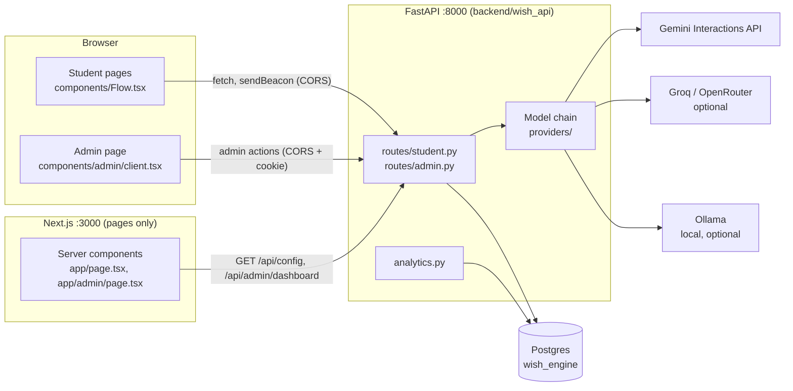
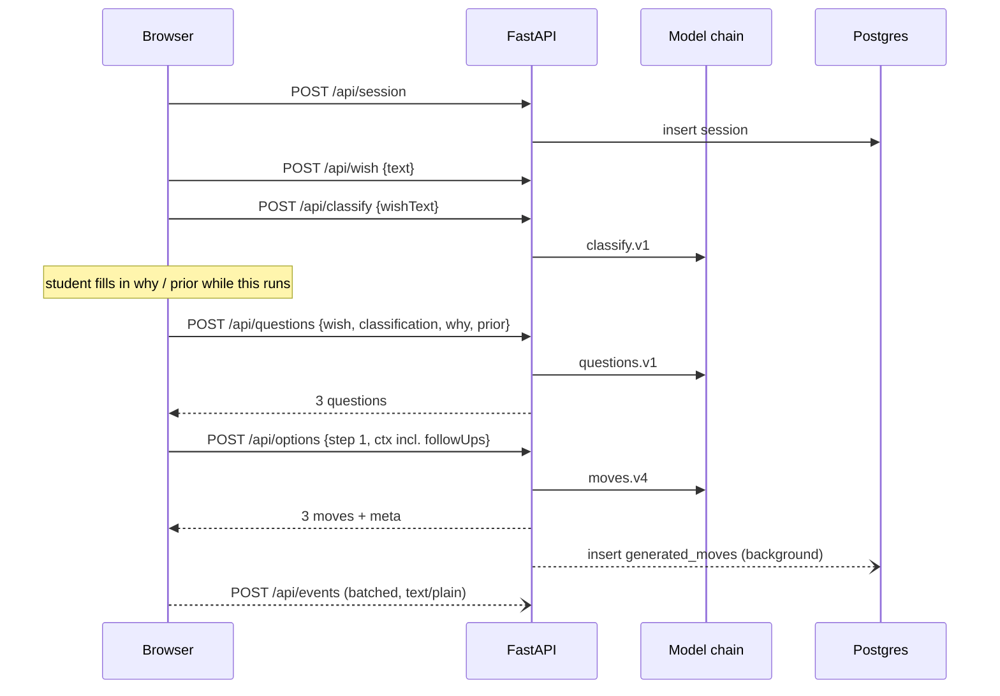
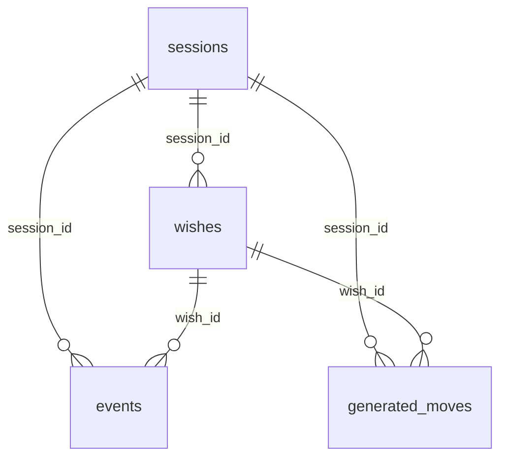

# Wish Engine architecture

The Wish Engine is a user-testing prototype. A student types a **wish** (something they want to make happen). They answer a few context questions, then see **3 move options** for their first step. Every pick, skip, reroll and reject is logged, and the student rates what they got. An admin page turns the logs into the numbers the study needs.

This document covers how the pieces fit together, the decisions behind them, the data model, and the API with sample requests and responses. Requirements live in `docs/PROMPT.md`. Working notes for whoever edits the code are in `CLAUDE.md`. Before exposing the app to the internet, read `docs/GOING-PUBLIC.md`.

---

## 1. System overview



| Piece | Tech | Responsibility |
|---|---|---|
| Frontend | Next.js 15 App Router, React 19, Tailwind 4 | Renders the student flow and the admin page. It has **no `/api` routes**: it holds no data and makes no model calls. |
| Backend | FastAPI, Python 3.13, SQLAlchemy 2 async Core, asyncpg, httpx, pydantic 2 | Every API route, the model chain, prompts, validation, analytics, CSV export. |
| Database | Postgres 15 | Sessions, wishes, the event log, generated moves, settings. |
| Models | Gemini (default), Groq / OpenRouter (if keyed), Ollama (if running locally) | Generate moves, follow-up questions and wish classification. |

**Two processes, two origins.** In development the pages are on `:3000` and the API on `:8000`. The browser calls the API directly, cross-origin: the same hostname as the page, on port 8000, or `NEXT_PUBLIC_API_URL`. The Next server reaches the API through `API_URL` for the two server-rendered calls (config, admin dashboard). In Docker the pages are on `:3010`, and the app container calls the API container at `http://api:8000`.

### Repository layout

```
app/                    Next pages: / (student flow), /terms, /admin
components/             Flow.tsx (state machine), screens.tsx, Pick.tsx, Summary.tsx, admin/client.tsx
lib/                    api.ts, client-api.ts, track.ts, types.ts, events.ts, archetypes.ts, follow-ups.ts, uuid.ts
data/                   wishes.json (starter chips), keywords.json (classifier fallback)
design/                 *.dc.html mockups: the single visual design
backend/wish_api/       FastAPI package
  main.py               app, CORS, routers
  routes/               student.py, admin.py, common.py
  providers/            model chain (backends, gemini, openai_compat, ollama, run, llm, health, queue, prefs, validate, options)
  prompts/              moves_v4.py, questions_v1.py, classify_v1.py, text.py
  db.py                 tables and engine
  analytics.py          pure stat and CSV-row functions
backend/scripts/        migrate, seed, llm_check, export_results
backend/tests/          pytest (no live model calls)
scripts/                e2e.ts (headless Chrome smoke test), backup.sh
```

---

## 2. The student flow

`components/Flow.tsx` is a client-side state machine:

```
welcome → intake → why → quiz → pick (× step) → [more] → summary → thanks
```

| Screen | What happens | Backend calls |
|---|---|---|
| welcome | Name (participant code) and consent. Consent text comes from `GET /api/config`, and the full terms are at `/terms`. | `POST /api/session` |
| intake | Student types a wish or taps a starter chip. | `POST /api/wish`; `POST /api/classify` runs **in the background** |
| why | "Why do you want this?" and "What have you tried?" (both optional). | `POST /api/wish`; starts `POST /api/questions` |
| quiz | Three follow-up questions written for this wish. A loading state shows while they are generated. | `POST /api/wish` (`followUps`); prefetches move 1 via `POST /api/options` |
| pick | 3 options. The student can lock one in, reroll, reject with a reason, or skip the step. | `POST /api/options` per set |
| more | Only with `FLOW_MOVES=3`: after move 3, offers moves 4 and 5. | |
| summary | Rating, "would you do this week", paid willingness, open feedback. | events only |

Events are batched throughout by `lib/track.ts` and sent to `POST /api/events`.



Move requests wait on the classification promise (`withClass` in `Flow.tsx`), so moves always see the classification.

---

## 3. Key decisions

| Decision | Why | Consequence |
|---|---|---|
| **Every move is generated by a model. No catalog, no static fallback, no cache.** | The study measures model-generated moves. Serving hand-written moves when a model fails would contaminate the data without anyone noticing. | If every model fails, the student sees "Try again" and `options_failed` is logged. Two students with the same wish get different options. |
| **The moves prompt has no wish-specific examples.** | Worked examples steered output toward fixed answers (for example, every DevOps wish got "learn AWS/Azure/GCP"). | One deliberately off-topic style example ("Cook dinner at home most weeknights") shows format and tone only. Real product names are allowed; prices are not (the model writes `[PRICE]`). The follow-up questions prompt contains no example questions either. |
| **Classification and follow-up questions degrade gracefully; moves do not.** | Classification and questions only *steer* the moves, so a fallback there doesn't fake the thing being measured. | If the classifier's models fail, keyword matching answers (`source: "keywords"`). If the questions' models fail, a fixed placeholder quiz is shown (`source: "fixed"`). |
| **A model chain with failover, not a single model.** | Gemini free-tier models get rate-limited, overloaded (503) and retired often. | Models are discovered at runtime and ranked. A failing model cools down and the next one is tried at once. See §6. |
| **Gemini through the Interactions REST API, stateless (`store: false`), no client retries.** | The SDK's built-in retries let one 503 hang a request for 231 s. Stateless calls carry the full prompt, so nothing depends on server-side conversation state. | The chain's own timeouts and failover are the only retry logic. See `docs/GEMINI-INTERACTIONS.md`. |
| **FastAPI backend, Next.js for pages only.** | The team wanted the backend in Python. It was ported from the original TypeScript routes, with byte-for-byte parity checks on prompts, ids, analytics and CSV output. | `jsutil.py` reproduces JS rounding, number formatting and JSON spacing so the outputs match the old backend. Two processes to run. |
| **Separate origins plus CORS, not a proxy.** | The setup is simple for local and LAN sessions, and it matches a later public deployment (`app.` and `api.` on one domain). | CORS with credentials. Events go as `text/plain`, so beacons and `keepalive` requests are "simple" requests with no preflight. Cookies ignore ports, so the admin cookie set by FastAPI reaches the Next server too. |
| **One uvicorn worker.** | Model health, cooldowns and the per-model Gemini rate queue live in memory. | Do not scale horizontally without moving that state to Postgres or Redis. |
| **Append-only event log as the source of truth for analytics.** | Every metric (funnel, pick rate by position, reject reasons, latency) can be recomputed from raw events. Changing a metric needs no migration. | `analytics.py` is pure functions over event rows. Payload keys are snake_case and analytics depends on them (§5.3). |
| **`/api/wish` is an upsert.** | The client fires partial wish updates (text, classification, why, follow-ups) without waiting, so they can arrive out of order. | Insert-or-update in one statement, applying only the fields sent. |
| **Client-made event ids.** | A batch retried after a lost response must not be stored twice. | `events.id` comes from the client; inserts use `ON CONFLICT DO NOTHING`. |
| **Local/LAN security posture only.** | It runs on the researcher's laptop in moderated sessions. | Rate limits, signed session cookies, an HTTPS proxy and the like were removed. They are kept at git tag `public-hardening` (TypeScript) and listed in `docs/GOING-PUBLIC.md`. |
| **Versioned prompts.** | Analytics compares results across prompt changes. | `PROMPT_VERSION` (`moves.v4`), `QUESTIONS_VERSION` (`questions.v1`) and `CLASSIFY_VERSION` (`classify.v1`) are logged on every call. Bump the version on any edit. |

---

## 4. Shared vocabulary

Defined twice, and the two copies must match: `lib/types.ts` (frontend) and `backend/wish_api/vocab.py` (backend).

| Name | Values |
|---|---|
| `Focus` | `learn`, `goal`, `system`, `advance`, `lead`, `connect` |
| `Domain` | `career` (Career & Industry), `academic` (Academic Foundation), `technical` (Technical Mastery), `venture` (Venture & Impact), `leadership` (Leadership & Network) |
| `WishType` | `fixed` (clear finish line), `open_ended` |
| `Archetype` | `builder`, `connector`, `planner`, `explorer` (placeholder quiz only) |
| `Format` | `solo`, `peer`, `group`, `mentor`, `course`, `project`, `event` |
| `Step` | 1 to 5. Step 1 is a quick first win (under about 60 min), step 2 builds on it, step 3 is the version the student ships, and steps 4 and 5 extend the path. |
| `FailReason` | `timeout`, `invalid_json`, `rate_limited`, `error` |

### Move

```ts
type Move = {
  id: string;            // "gen-" + sha1(normalizedTitle + "|" + step)[:10]
  title: string;         // imperative, ≤ 60 chars (truncated with "…")
  detail: string;        // exactly one sentence (trimmed to the first sentence)
  step: 1 | 2 | 3 | 4 | 5;
  focus: Focus[];
  domains: Domain[];
  minutes: number;       // integer, 1..100000
  cost: "free" | "paid";
  format: Format;
  archetypeFit: Partial<Record<Archetype, number>>;  // 0..1, used for ranking only
};
```

The same move text at the same step always gets the same id. That lets the leaderboard count how often a move was shown or picked across students. "Normalized" means lowercased, keeping only letters, digits and single spaces.

**Rules every option set must pass** (`providers/llm.py` `assemble`):
- exactly 3 distinct moves, with no title repeating one already shown, rejected or locked;
- at least 2 free and at most 1 paid;
- all free if the student rejected the last set with "Don't want to pay".

A set that breaks a rule is either repaired (dedupe, drop the extra paid move) or sent back to the model with the problem spelled out.

---

## 5. Data model

Tables are defined in `backend/wish_api/db.py` (SQLAlchemy Core) and created by `npm run db:push` (`backend/scripts/migrate.py`: `create_all`, plus the `ADDED_COLUMNS` ALTERs for columns added later). There are no foreign keys. Rows are linked by `session_id` and `wish_id`.

### 5.1 Tables

**`sessions`**: one per participant visit, created after consent.

| Column | Type | Notes |
|---|---|---|
| `id` | uuid PK | made by the client |
| `participant_code` | text, not null | the name entered on the welcome screen (≤ 64 chars) |
| `provider` | text | `MOVE_PROVIDER` at the time (`auto`, `gemini`, `ollama`) |
| `app_version` | text | `0.1.0` |
| `consented` | bool, default false | always true in practice (the route refuses otherwise) |
| `created_at` | timestamptz, default now() | |

**`wishes`**: one per wish. A session can have several (Start over, Do another).

| Column | Type | Notes |
|---|---|---|
| `id` | uuid PK | made by the client |
| `session_id` | uuid, not null | |
| `text` | text, not null | the wish, ≤ 500 chars |
| `from_chip` | bool | true if the student tapped a starter chip |
| `type` | text | `fixed` / `open_ended` |
| `focus`, `domains` | jsonb `string[]` | current classification |
| `guessed_focus`, `guessed_domains` | jsonb `string[]` | what the classifier said first |
| `archetype` | text | from the fixed quiz only |
| `why` | text | ≤ 1000 chars |
| `prior_attempts` | jsonb | `{ "chips": string[], "text"?: string }` |
| `follow_ups` | jsonb | `[{ "question", "answer", "note" }]`, the answered generated questions |
| `created_at` | timestamptz | |

**`events`**: the append-only log. Analytics reads this table.

| Column | Type | Notes |
|---|---|---|
| `id` | uuid PK | made by the client (dedupe); server default `gen_random_uuid()` |
| `created_at` | timestamptz | server time |
| `client_ts` | timestamptz | browser time |
| `session_id` | uuid, not null | indexed |
| `wish_id` | uuid | |
| `participant_code` | text, not null | copied onto every row so exports need no joins |
| `app_version` | text, not null | |
| `provider` | text | `payload.used_provider` if present, else `MOVE_PROVIDER` |
| `name` | text, not null | one of the event names in §5.3; indexed |
| `step` | int | 1..5 for step-level events |
| `payload` | jsonb, default `{}` | per event, see §5.3 |

**`generated_moves`**: every move a model produced, written in the background after a response is sent.

| Column | Type | Notes |
|---|---|---|
| `id` | text | the `gen-…` move id |
| `session_id` | uuid | PK is (`id`, `session_id`) |
| `wish_id` | uuid | |
| `step` | int | |
| `move` | jsonb | the full Move object |
| `provider`, `model`, `prompt_version` | text | which model wrote it, under which prompt |
| `created_at` | timestamptz | |

**`settings`**: small key/value store.

| key | value |
|---|---|
| `preferred_backend` | backend id the admin chose to "Try first", or null |

### 5.2 Entity relationships



### 5.3 Event catalog

Defined in `lib/events.ts` and `backend/wish_api/events_schema.py`; the two lists must match. Payload keys are **snake_case** and `analytics.py` reads them by name, so do not rename them.

| Event | Step | Payload |
|---|---|---|
| `session_started` | | `user_agent`, `viewport` |
| `consent_given` | | |
| `wish_submitted` | | `text`, `from_chip` |
| `classification_guessed` | | `focus`, `domains`, `type`, `source` (`llm`/`keywords`/`none`), `provider`, `model`, `prompt_version`, `latency_ms`, `tried` or `fail_reason` |
| `classification_confirmed` | | (older rows; the confirmation screen was removed) |
| `why_submitted` | | `text`, `skipped` |
| `prior_attempts_submitted` | | `chips`, `text`, `skipped` |
| `questions_shown` | | `source` (`llm`/`fixed`), `provider`, `model`, `prompt_version`, `latency_ms`, `tried`, `fail_reason`, `questions[{id, prompt, answers[], note}]` |
| `quiz_answered` | | `q`, `answer`, `question`, `answer_text`, `source` |
| `quiz_skipped` | | `answered`, `source` |
| `archetype_assigned` | | `archetype`, `answers` (fixed quiz only) |
| `options_shown` | ✓ | `move_ids`, `reroll_index`, `relaxed`, `sources`, `requested_provider`, `used_provider`, `model`, `prompt_version`, `latency_ms`, `cache_hit`, `repaired`, `tried` |
| `options_failed` | ✓ | `reason`, `reroll_index` |
| `option_selected` / `option_deselected` | ✓ | `move_id`, `position`, `ms_since_shown` |
| `move_locked` | ✓ | `move_id`, `position`, `ms_since_shown`, `reroll_index` |
| `options_rejected` | ✓ | `reason_chip`, `text`, `move_ids` |
| `options_feedback` | ✓ | `answer` ("were these useful") |
| `step_skipped` | ✓ | `reroll_index` |
| `path_completed` | | `move_ids` |
| `path_rated` | | `rating` |
| `would_do_this_week` | | `answer` |
| `paid_willingness` | | `move_id`, `answer` |
| `open_feedback` | | `text` |
| `start_over` | | `last_screen` |
| `session_abandoned` | | `last_screen` (sent on pagehide) |
| `provider_fallback`, `options_relaxed` | ✓ | legacy; no longer emitted in practice |

`cache_hit` is always false and `sources` is always `"generated"`. Both are kept so older rows (from before moves.v3, when a catalog existed) still read the same way. Old rows may also hold catalog-slug move ids.

---

## 6. The model chain

All three model tasks (moves, questions, classify) go through one runner: `providers/llm.py` `run_chain` calls `providers/run.py` `run_llm`.

```
get_backends()  ─▶ health.order(backends, preferred) ─▶ for each backend:
                                                          acquire rate slot (Gemini)
                                                          build prompt (with fix-up hint on retry)
                                                          generate(system, user, schema, temperature)
                                                          parse + validate
                                                            ok          → return
                                                            invalid     → retry once with the error as hint, then next backend
                                                            error/429/timeout → cool down this backend, next backend
                                                        all failed or budget spent → LlmUnavailable(reason)
```

**Discovery** (`backends.py`, cached for 10 min; the admin "Re-discover" button refreshes it):
- **Gemini:** `ListModels`, filtered to text flash and pro models and ranked flash-lite > flash > pro, then stable > preview, then newest version first. At most `GEMINI_MAX_MODELS` models. `GEMINI_MODELS` pins a list instead. If listing fails, the chain falls back to `gemini-3.5-flash-lite` and `gemini-flash-lite-latest`.
- **Groq / OpenRouter:** each joins if its API key is set (OpenRouter `:free` models only).
- **Ollama:** joins if a local server answers at `OLLAMA_URL`.

`MOVE_PROVIDER=gemini` or `ollama` limits the chain to that one service.

**Health** (`health.py`, in memory):
- A failure puts that model on cooldown for 1, 2, 4 ... up to 10 min.
- Rate limits cool down for 30 s.
- A used-up daily quota cools down until midnight Pacific, when Gemini quotas reset.
- 401, 403 and 404 mark a model "gone" for 6 h.
- Healthy models come first, with the admin's preferred one at the front. Cooling models follow, soonest-recovering first.

**Rate queue** (`queue.py`): each Gemini model allows `GEMINI_RPM` (default 9) request starts per rolling minute, FIFO. If a slot is more than 3 s away, the chain skips to the next model rather than wait.

**Time limits:**

| Setting | Default | Scope |
|---|---|---|
| `LLM_TIMEOUT_MS` | 12 000 | one model call |
| `LLM_BUDGET_MS` | 60 000 | a whole moves request, across every model tried |
| `CLASSIFY_BUDGET_MS` | 20 000 | classification (then keywords) |
| `QUESTIONS_BUDGET_MS` | 20 000 | follow-up questions (then fixed quiz) |

**Prompts:**

| Task | Module | Version | Temperature | Output |
|---|---|---|---|---|
| Moves | `prompts/moves_v4.py` | `moves.v4` | 0.8 | `{ moves: [3 × Move without id] }` |
| Follow-up questions | `prompts/questions_v1.py` | `questions.v1` | 0.7 | `{ questions: [3 × {prompt, answers[3–4], note}] }` |
| Classification | `prompts/classify_v1.py` | `classify.v1` | backend default (0.4) | `{ focus[1–2], domains[1–2], type }` |

Prompt text lives in `prompts/text.py`. Each request passes a JSON schema to the model (Gemini `response_format`, Ollama `format`), and pydantic then validates the output again on the server.

The moves prompt is built from:
- the wish, type, focus and domains;
- why, prior attempts, follow-up answers and archetype;
- moves already locked;
- on a reroll, titles already shown;
- on a reject, the rejected moves and the reason, which maps to a hint such as "Too big" → "make the new options smaller and quicker".

---

## 7. API reference

Base URL: `http://<host>:8000`. Interactive OpenAPI docs are at `/docs`.

**Conventions**
- Request bodies are JSON. They are parsed whatever the `Content-Type`, because beacons arrive as `text/plain`.
- Success responses are `{"ok": true, ...}`.
- Validation errors are `400 {"ok": false, "error": "<pydantic message>"}`, not FastAPI's default 422.
- Database errors return `503 {"ok": false, "reason": "db"}` (so the client retries) on session and wish, and `500` on events.
- Field names in requests and responses are camelCase. Event payloads (§5.3) are snake_case.
- CORS allows credentials. Default origins are localhost and private LAN addresses on any port; `CORS_ORIGINS` overrides them.
- Admin routes need the `wish_admin` cookie; without it they return `401 {"ok": false}`.

### Student routes (`routes/student.py`)

| Method | Path | Purpose |
|---|---|---|
| GET | `/api/health` | Liveness check: `{"ok": true}` |
| GET | `/api/config` | Flow length and consent text |
| POST | `/api/session` | Create a session after consent |
| POST | `/api/wish` | Upsert a wish (partial updates) |
| POST | `/api/classify` | Classify a wish (falls back to keywords) |
| POST | `/api/questions` | 3 follow-up questions (falls back to the fixed quiz) |
| POST | `/api/options` | 3 moves for a step (no fallback) |
| POST | `/api/events` | Batch of up to 100 events |

### Admin routes (`routes/admin.py`)

| Method | Path | Purpose |
|---|---|---|
| POST | `/api/admin/login` | `{password}`; sets the `wish_admin` cookie (12 h, httpOnly, SameSite=Lax) |
| GET | `/api/admin/dashboard` | Everything the admin page renders. Filters: `from`, `to` (YYYY-MM-DD), `participant`, `provider` |
| GET | `/api/admin/export/{kind}` | CSV, where `kind` is `events`, `choices`, `feedback` or `moves`. Same filters. UTF-8 with BOM; text cells starting with `= + - @` are escaped |
| POST | `/api/admin/models` | `{"action": "prefer", "id": "<backend id>" \| null}`, `{"action": "test"}` (ping every model), `{"action": "refresh"}` (re-discover) |
| GET | `/api/admin/delete-test` | Preview the sessions whose code matches `^TEST[ _-]` |
| POST | `/api/admin/delete-test` | `{"expect": <previewed count>}`; deletes those sessions and their rows. `409` if the count changed since the preview |

---

## 8. Sample requests and responses

Where noted, samples are real. The rest are built from the code's schemas and marked as illustrative.

### `GET /api/config` (real)

```json
{
  "flowMoves": 1,
  "consent": {
    "intro": "This is a prototype. It suggests first moves for something you want to make happen. Your choices and feedback are saved under the name you enter below, so the researcher can tell participants apart. Please don't type other personal details (like contact info) into any text field.",
    "data": "What you type in the wish, why, and prior-attempts fields is sent to an outside model service (Google Gemini) to generate options, and may be reviewed by that service. Your name is not sent."
  }
}
```

### `POST /api/session`

```json
// request
{ "sessionId": "3f6c1e2a-8b4d-4c1e-9a7f-2d5b6e8c9a01", "participantCode": "P07", "consented": true }
// response
{ "ok": true, "provider": "auto" }
```

### `POST /api/wish`: three partial updates for one wish

```json
{ "id": "a1b2c3d4-0000-4000-8000-000000000001", "sessionId": "3f6c1e2a-8b4d-4c1e-9a7f-2d5b6e8c9a01",
  "text": "Pass technical interviews", "fromChip": true }

{ "id": "a1b2c3d4-0000-4000-8000-000000000001", "sessionId": "3f6c1e2a-8b4d-4c1e-9a7f-2d5b6e8c9a01",
  "guessedFocus": ["goal"], "guessedDomains": ["career"], "focus": ["goal"], "domains": ["career"], "type": "fixed" }

{ "id": "a1b2c3d4-0000-4000-8000-000000000001", "sessionId": "3f6c1e2a-8b4d-4c1e-9a7f-2d5b6e8c9a01",
  "why": "I freeze on live coding rounds", "priorAttempts": { "chips": ["leetcode grinding"] } }
```

Each response is `{ "ok": true }`. Only the fields sent are written.

### `POST /api/classify` (response is a real logged result)

```json
// request
{ "wishText": "Pass technical interviews" }
// response
{
  "ok": true, "focus": ["goal"], "domains": ["career"], "type": "fixed",
  "source": "llm", "provider": "gemini", "model": "gemini-3.5-flash-lite",
  "prompt_version": "classify.v1", "latency_ms": 1260, "tried": []
}
// when every model fails (illustrative)
{ "ok": true, "focus": ["goal"], "domains": ["career"], "type": "fixed", "source": "keywords", "fail_reason": "timeout", "latency_ms": 20003 }
```

This route's response keys are snake_case because the client logs it straight into `classification_guessed`.

### `POST /api/questions` (real, live call)

```json
// request
{
  "wishText": "Pass technical interviews", "type": "fixed", "focus": ["goal"], "domains": ["career"],
  "why": "I freeze on live coding rounds", "prior": { "chips": ["LeetCode grinding"] }
}
// response
{
  "ok": true, "source": "llm",
  "questions": [
    { "id": "g1", "prompt": "What happens when you freeze during live coding?", "note": "identifies the specific failure mode",
      "answers": [ { "id": "a", "label": "Blank out on syntax" }, { "id": "b", "label": "Forget problem approach" },
                   { "id": "c", "label": "Panic from timer pressure" }, { "id": "d", "label": "Freeze when interviewer speaks" } ] },
    { "id": "g2", "prompt": "How much time do you have left?", "note": "determines the urgency of the preparation",
      "answers": [ { "id": "a", "label": "Under one month" }, { "id": "b", "label": "One to three months" },
                   { "id": "c", "label": "More than three months" } ] },
    { "id": "g3", "prompt": "What format of practice helps you most?", "note": "reveals preferred learning modality",
      "answers": [ { "id": "a", "label": "Simulated mock interviews" }, { "id": "b", "label": "Writing code on paper" },
                   { "id": "c", "label": "Explaining solutions out loud" } ] }
  ],
  "provider": "gemini", "model": "gemini-3.5-flash-lite", "promptVersion": "questions.v1", "latencyMs": 1358, "tried": []
}
```

Question and answer ids are positional (`g1`..`g3`, `a`..`d`). `note` says what the question is meant to find out and is never shown to the student. When the models fail, the response is `"source": "fixed"` with the placeholder quiz (ids `q1`..`q3`) and a `failReason`.

### `POST /api/options`

Request (illustrative; the shape is `OptionsBody` in `routes/student.py`):

```json
{
  "sessionId": "3f6c1e2a-8b4d-4c1e-9a7f-2d5b6e8c9a01",
  "wishId": "a1b2c3d4-0000-4000-8000-000000000001",
  "step": 1,
  "rerollIndex": 0,
  "excludeIds": [],
  "ctx": {
    "wishText": "Pass technical interviews",
    "type": "fixed", "focus": ["goal"], "domains": ["career"],
    "why": "I freeze on live coding rounds",
    "prior": { "chips": ["leetcode grinding"] },
    "followUps": [
      { "question": "What happens when you freeze during live coding?", "answer": "Panic from timer pressure", "note": "identifies the specific failure mode" },
      { "question": "How much time do you have left?", "answer": "One to three months", "note": "determines the urgency of the preparation" }
    ],
    "chosen": []
  }
}
```

Response. The moves and meta values are from a real run, which used the earlier `moves.v2` prompt; today `promptVersion` reads `moves.v4`.

```json
{
  "ok": true,
  "moves": [
    { "id": "gen-09566e69aa", "title": "Complete one timed blind neetcode medium",
      "detail": "Set a strict 45-minute timer, solve a random medium problem without looking up hints, and write down every point where you hesitated.",
      "step": 1, "focus": ["goal"], "domains": ["career"], "minutes": 50, "cost": "free", "format": "solo",
      "archetypeFit": { "builder": 0.9, "planner": 0.5, "explorer": 0.4, "connector": 0.1 } },
    { "id": "gen-8d9ad124b7", "title": "Do a 30-minute peer mock interview",
      "detail": "Pair up with another senior to give each other a data structures problem while actively practicing out-loud communication under pressure.",
      "step": 1, "focus": ["goal", "connect"], "domains": ["career"], "minutes": 40, "cost": "free", "format": "peer",
      "archetypeFit": { "builder": 0.5, "planner": 0.3, "explorer": 0.2, "connector": 0.9 } },
    { "id": "gen-2514db2131", "title": "Audit your failure patterns from past practice",
      "detail": "Review your last three failed technical questions, categorize each mistake as algorithmic, syntactic, or communication-based, and list the fix.",
      "step": 1, "focus": ["goal", "learn"], "domains": ["career"], "minutes": 45, "cost": "free", "format": "solo",
      "archetypeFit": { "builder": 0.4, "planner": 0.9, "explorer": 0.5, "connector": 0.1 } }
  ],
  "meta": {
    "requestedProvider": "auto", "usedProvider": "gemini", "model": "gemini-3.5-flash-lite",
    "promptVersion": "moves.v4", "latencyMs": 2215, "cacheHit": false, "repaired": false,
    "relaxed": false, "sources": ["generated", "generated", "generated"], "tried": []
  }
}
```

A reroll after a reject adds the following fields (illustrative):

```json
{
  "rerollIndex": 1,
  "excludeTitles": ["Complete one timed blind neetcode medium", "Do a 30-minute peer mock interview", "Audit your failure patterns from past practice"],
  "rejectReason": { "chip": "too big" },
  "rejectedMoves": [ /* the 3 Move objects above */ ]
}
```

When every model fails (no moves are substituted):

```json
// 503
{ "ok": false, "reason": "timeout" }
```

`reason` is one of `timeout`, `invalid_json`, `rate_limited` or `error`. The page shows "Try again" and logs `options_failed`.

### `POST /api/events`

```json
{
  "events": [
    {
      "id": "7d1f0e7a-2c3b-4a5d-8e9f-0a1b2c3d4e5f",
      "name": "move_locked",
      "clientTs": "2026-11-03T18:22:41.512Z",
      "sessionId": "3f6c1e2a-8b4d-4c1e-9a7f-2d5b6e8c9a01",
      "wishId": "a1b2c3d4-0000-4000-8000-000000000001",
      "participantCode": "P07",
      "step": 1,
      "payload": { "move_id": "gen-8d9ad124b7", "position": 2, "ms_since_shown": 14210, "reroll_index": 0 }
    }
  ]
}
```

Response: `{ "ok": true }`. The client sends this with `Content-Type: text/plain` (see §3).

### Validation error (real)

```json
// 400, POST /api/options without ctx
{ "ok": false, "error": "1 validation error for OptionsBody\nctx\n  Field required [type=missing, ...]" }
```

### Admin

```json
// POST /api/admin/login  { "password": "..." }
{ "ok": true }                                  // + Set-Cookie: wish_admin=...
{ "ok": false, "error": "Wrong password." }     // 401

// POST /api/admin/models  { "action": "test" }
{ "ok": true,
  "results": [ { "id": "gemini:gemini-3.5-flash-lite", "ok": true, "ms": 1180 },
               { "id": "gemini:gemini-3.1-flash-lite", "ok": false, "ms": 412, "error": "LLM unavailable (error): 503 ..." } ],
  "health": { "gemini:gemini-3.5-flash-lite": { "coolUntil": 0, "fails": 0, "gone": false, "lastOkAt": 1762194161000, "lastLatencyMs": 1180, "lastError": null, "lastErrorAt": null } } }

// GET /api/admin/delete-test
{ "ok": true, "count": 2, "codes": ["TEST Waleed", "TEST-3"] }
// POST /api/admin/delete-test  { "expect": 2 }
{ "ok": true, "deleted": 2 }
{ "ok": false, "reason": "changed", "count": 3 }   // 409
```

`GET /api/admin/dashboard` returns one object. Its exact shape is the `Dashboard` type in `lib/admin-types.ts`:

```json
{
  "ok": true, "eventCount": 103, "wishCount": 8,
  "sessions": [ { "id": "...", "participant": "P07" } ],
  "journeys": [ /* per session → per wish → per step → rounds (picked / rejected / skipped) */ ],
  "meta": { "gen-8d9ad124b7": { "id": "gen-8d9ad124b7", "title": "Do a 30-minute peer mock interview", "step": 1, "focus": ["goal", "connect"], "cost": "free", "source": "generated" } },
  "generated": { "gen-8d9ad124b7": { /* full Move */ } },
  "models": { "rows": [ { "id": "gemini:gemini-3.5-flash-lite", "status": "ok", "note": "answered 2 min ago in 1180 ms" } ], "preferred": null },
  "usage": { "gemini:gemini-3.5-flash-lite": { "n": 5, "median": 2215, "failover": 0 } },
  "classSrc": { "llm": 8 },
  "failedLoads": 2,
  "funnel": [ { "label": "Sessions", "n": 6 }, { "label": "Consented", "n": 6 }, { "label": "Wish submitted", "n": 6 },
              { "label": "Move 1 locked", "n": 5 }, { "label": "Move 2 locked", "n": 0 }, { "label": "Move 3 locked", "n": 0 },
              { "label": "Path rated", "n": 5 } ],
  "leaderboard": [ { "id": "gen-8d9ad124b7", "title": "...", "shown": 1, "picked": 1, "pickRate": 1, "rejected": 0, "medianDecisionMs": 14210,
                     "pickRatePos1": null, "pickRatePos2": 1, "pickRatePos3": null, "source": "generated", "step": 1, "focus": "goal|connect", "cost": "free" } ],
  "rejectReasons": { "1": { "too big": 1 } },
  "feedback": { "avgRating": 4.2, "ratings": 5, "wouldDoThisWeek": { "yes": 3, "maybe": 2 }, "paidWillingness": {}, "optionsUseful": {}, "openText": [] },
  "byProvider": { "auto": { "sessions": 6, "completedRated": 5, "completionRate": 0.83, "avgRating": 4.2, "medianLatencyMs": 2215, "...": "..." } },
  "wishTallies": { "area": { "career": 6 }, "focus": { "goal": 5 }, "finish": { "clear": 5, "open-ended": 1 }, "archetype": { "none": 6 } }
}
```

(The dashboard numbers are illustrative.)

---

## 9. Frontend internals

| File | Role |
|---|---|
| `lib/api.ts` `apiUrl()` | Resolves the API base. In the browser: `NEXT_PUBLIC_API_URL`, else the page's host on `NEXT_PUBLIC_API_PORT` (8000). On the server: `API_URL`, else `http://127.0.0.1:8000`. |
| `lib/client-api.ts` | `postRaw` retries network errors, 429 and 5xx with backoff, honouring `Retry-After`. Options get one try, because the server already walked the chain and the student has a retry button. `classify` and `fetchQuestions` never reject: on network failure they return an empty classification or the fixed quiz. |
| `lib/track.ts` | Event queue that flushes after 1.5 s in batches of up to 100. A failed batch is re-queued with backoff (2 to 60 s), keeping at most 1000 events. On `pagehide` it sends by `sendBeacon`. Nothing is tracked until `setConsent(true)`. |
| `lib/server-config.ts` | `GET /api/config` from server components. If the API is down, the page renders `components/ApiDown.tsx`. |
| `components/Flow.tsx` | Screen state machine, prefetching (move 1 after the questions; the next step after a lock with `FLOW_MOVES=3`), and the classification promise. |
| `components/Pick.tsx` | One step: load a set, select, lock, reroll, reject with a chip (Too big, Too small, Not my style, Already done this, Don't want to pay, Other), skip. |
| `app/admin/page.tsx` | Server component that fetches the dashboard, forwarding the `wish_admin` cookie. A 401 renders the login form. |
| `lib/uuid.ts` | Use instead of `crypto.randomUUID`, which is undefined on plain-http LAN URLs. |

Design: a single visual design, from the `design/*.dc.html` mockups (Figtree, blue band header, pill chips). There are no themes, and the admin page uses the same design. Copy is written for senior ASU CS majors: say "moves" and "options", with no "AI" wording and no emoji.

---

## 10. Configuration

All settings are environment variables in one `.env` at the repo root, read by both apps. Template: `.env.example`.

| Variable | Default | Effect |
|---|---|---|
| `DATABASE_URL` | (required) | Postgres URL. `postgres://` is rewritten to `postgresql+asyncpg://`. |
| `ADMIN_PASSWORD` | (empty: admin disabled) | Admin login. |
| `MOVE_PROVIDER` | `auto` | `auto`, `gemini` or `ollama`. |
| `GEMINI_API_KEY` | | Enables Gemini. |
| `GEMINI_MODELS` | (discover) | Comma list that pins Gemini models in order. |
| `GEMINI_MAX_MODELS` / `GEMINI_RPM` | 10 / 9 | Discovery cap / per-model requests per minute. |
| `GROQ_API_KEY`, `OPENROUTER_API_KEY` | | Optional backup services. |
| `OLLAMA_URL`, `OLLAMA_MODEL` | `http://localhost:11434`, `llama3.1:8b` | Local backup. |
| `LLM_TIMEOUT_MS`, `LLM_BUDGET_MS`, `CLASSIFY_BUDGET_MS`, `QUESTIONS_BUDGET_MS` | 12000, 60000, 20000, 20000 | See §6. |
| `FLOW_MOVES` | `1` | `1`: pick one move, then rate it. `3`: full path of moves 1 to 3 (up to 5). |
| `CORS_ORIGINS` | (localhost + private LAN) | Comma list of allowed page origins. |
| `API_URL` | `http://127.0.0.1:8000` | Where the Next server reaches the API. |
| `NEXT_PUBLIC_API_URL` / `NEXT_PUBLIC_API_PORT` | (same host) / `8000` | Where the browser reaches the API. Baked in at build time. |
| `DATA_DIR` | `data/` | Location of `keywords.json` for the backend. |

---

## 11. Running, testing, operating

| Task | Command |
|---|---|
| First-time setup | `npm install`, `npm run api:setup`, `npm run db:push` |
| Develop | `npm run api` (`:8000`, auto-reload) + `npm run dev` (`:3000`) |
| LAN session | `npm run api:lan` + `npm run dev:lan`; students open `http://<laptop-ip>:3000` |
| Docker | `docker compose up -d --build`: `db`, `migrate` (exits), `api` `:8000`, `app` `:3010` |
| Tests | `npm test`: vitest (frontend), then pytest (`backend/tests`: mocked chain, prompts, analytics, CSV). No live model calls, no database. |
| Types | `npm run typecheck` |
| Check models | `npm run llm:check -- "some wish" --all` pings every model and generates one sample set |
| End-to-end | `BASE_URL=http://localhost:3000 npx tsx scripts/e2e.ts [--phone]` (needs the API, the dev server and Chrome; uses `TEST` codes) |
| Export | `/admin` CSV links, or `npm run export` (writes `exports/results.csv` and `.md`) |
| Backup | `npm run backup` writes `backups/*.sql.gz` |

---

## 12. Things to know

- **Keep the two copies in sync.** `lib/types.ts` ↔ `vocab.py` and the pydantic models; `lib/events.ts` ↔ `events_schema.py`; `lib/archetypes.ts` ↔ `archetypes.py`. Nothing checks this automatically.
- **Do not rename event payload keys.** The analytics and the exported CSVs depend on them.
- **Bump the prompt version on any prompt or schema edit.** Otherwise results from different prompts get mixed together in the analytics.
- **In-memory state.** Model health, cooldowns, the Gemini rate queues and backend discovery reset when the API restarts. The admin "Try first" choice survives restarts because it is stored in `settings`.
- **Background writes.** `generated_moves` is written after the response is sent. If that insert fails, the student still sees the moves, but the admin leaderboard shows the bare id without a title.
- **Beacon events are best-effort.** Events sent on page close by `sendBeacon` can't be retried.
- **Gemini models change often.** Model names get retired and "flash" models return 503 under load. The chain handles both, but check `npm run llm:check` before each session.
- **Free-tier data use.** On the free tier, Google may use prompts and humans may review them. The consent text says so; check it against the IRB protocol.
- **Personal data.** `participant_code` is whatever name the student typed, and free-text fields may contain personal details. Export, back up, then delete after the study.
- **Placeholder archetype quiz.** The fixed quiz and its archetype names are stand-ins (`archetypes.py` says "PLACEHOLDER"). It is only shown when question generation fails.
- **Dead setting.** `SHUFFLE_POSITIONS` is in `.env.example` and `config.py`, but nothing reads it. Options are shown in the order the model returned them.
- **Going public.** Rate limits, signed session and admin cookies, body size caps, security headers and an HTTPS proxy all need porting from the `public-hardening` tag to FastAPI first. See `docs/GOING-PUBLIC.md`.
