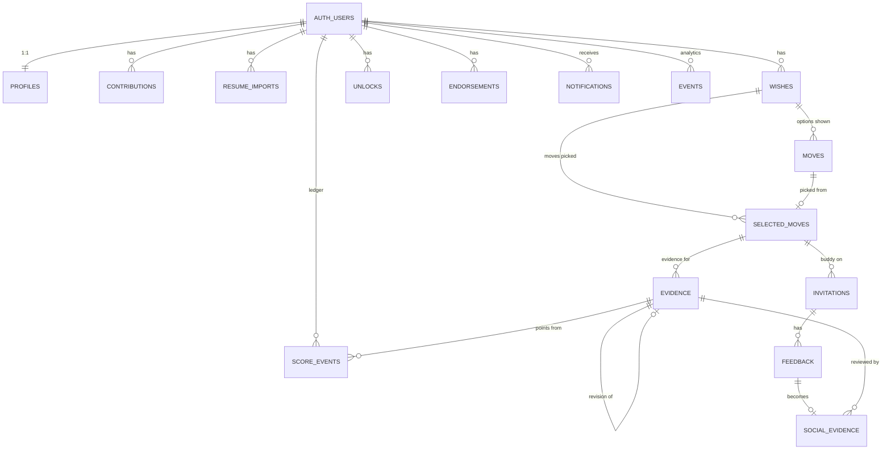

# Data model

The data lives in one Supabase Postgres database, split into one schema per module (T-06).
- A module reads and writes only its own schema.
- Other modules' data is reached through their `api.py` (see `ARCHITECTURE.md`).
- Tables are created by SQL migrations in `supabase/migrations` (T-07). The SQLAlchemy definitions in each module's `tables.py` must match them, and a test checks that they do.

**Conventions**
- Primary keys are `uuid default gen_random_uuid()`.
- Every user-owned row has `user_id uuid not null references auth.users(id) on delete cascade`, so deleting an account deletes its data.
- Rows have `created_at timestamptz not null default now()`.
- Row-level security is enabled on every table, with no policies: nothing is reachable through Supabase's public data API.
- **Cross-module foreign keys point only at "anchor" rows:** users, wishes, selected moves and evidence. Nothing else crosses a module boundary.

## Ownership

| Schema | Owner module | Tables |
|---|---|---|
| `core` | platform | `settings`, `events` |
| `profile` | M1 Professional State (Cfoley5) | `profiles`, `contributions`, `resume_imports` |
| `wish` | M2 Wish Engine (Waleed) | `wishes`, `moves`, `selected_moves` |
| `growth` | M3 Growth (Christina Phan) | `evidence`, `score_events`, `unlocks`, `endorsements` |
| `social` | M4 Buddies (Michael Hawes) | `invitations`, `feedback`, `social_evidence` |
| `feed` | M5 Events (JBarroqu) | `notifications` |

The careers, skills and opportunities are **not** tables. They are loaded from `data/catalog.json` at startup (D-09, D-27).

## Diagram

## Tables

### core
**`core.settings`**: `key text pk, value jsonb, updated_at timestamptz, updated_by text`
- Admin policy overrides use keys like `policy:VALIDATION_MODE`.
- Also stores the admin "try this model first" choice and the cookie signing key, unless `SESSION_SECRET` is set.

**`core.events`**: the analytics log (from the Wish Engine `events` table).
- `id uuid pk` (made by the client, so a retried batch is stored once), `user_id fk`, `client_session_id uuid`, `wish_id uuid null`, `name text`, `step int null`, `payload jsonb`, `app_version`, `provider`, `created_at`.
- Indexes on `(user_id, created_at)` and `(name, created_at)`.
- Payload keys are snake_case, as in the Wish Engine. Admin analytics depends on them.

### profile (M1)
**`profile.profiles`**
- `user_id uuid pk fk auth.users`
- `handle citext unique` (`^[a-z0-9_]{3,24}$`; null until onboarding)
- `display_name`, `headline`, `bio`
- `education jsonb {institution, major, gradYear}`, `position`, `target_career_id text`
- `skills text[]`, `interests text[]`, `strengths text[]`, `growth_areas text[]`
- `onboarding_completed_at timestamptz null`
- `last_seen_at`, `previous_seen_at` (for While You Were Away)
- `version int default 1`, `updated_at`

The row is created by a trigger when a user signs up.

**`profile.contributions`**
- `id`, `user_id fk`, `title`
- `type check in (project, coursework, professional, other)`, `description`
- `verification_status check in (self_reported, verified)`, set to `verified` only by the server
- `evidence_id uuid null fk growth.evidence`
- `position int`, `created_at`

**`profile.resume_imports`**
- `id`, `user_id fk`, `storage_path text null` (null once deleted), `mime`, `size_bytes`
- `status check in (uploaded, parsed, failed, applied, discarded)`
- `text_chars`, `draft jsonb`, `provider`, `model`, `prompt_version`, `error`, `created_at`

### wish (M2)
**`wish.wishes`**
- `id`, `user_id fk`, `text`, `from_chip bool`
- `type`, `focus jsonb`, `domains jsonb`, `guessed_type`, `guessed_focus`, `guessed_domains`
- `archetype`, `why`, `prior_attempts jsonb`, `follow_ups jsonb`
- `status check in (active, completed, abandoned)`, `current_step int default 1`
- `profile_version int`, `created_at`, `updated_at`

`POST /wishes` stays an upsert: the client sends partial updates that can arrive out of order.

**`wish.moves`**: every option shown. It replaces the Wish Engine's `generated_moves`.
- `id`, `user_id fk`, `wish_id fk`
- `move_key text` (`gen-` + hash of title and step)
- `step`, `position`, `reroll_index`
- `payload jsonb` (the full move, including activityType, difficulty, skillId, careerId)
- `provider`, `model`, `prompt_version`, `latency_ms`, `created_at`
- Index on `(wish_id, step)`.

**`wish.selected_moves`**
- `id`, `user_id fk`, `wish_id fk`, `move_id fk wish.moves`, `step`
- `contract jsonb` (the SelectedMove v0.1 snapshot)
- `skill_id`, `activity_type`, `difficulty`
- `status check in (active, evidence_submitted, awaiting_review, validated, needs_work, abandoned)`
- `selected_at`, `closed_at`
- A partial unique index `(wish_id) where status not in ('validated','abandoned')` allows one open move per wish when `MOVES_PER_WISH=1` (D-02).

### growth (M3)
**`growth.evidence`** (from Growth-Validation `evidence`)
- `id`, `user_id fk`, `selected_move_id fk wish.selected_moves`, `revision_of uuid null fk growth.evidence`
- Scoring inputs, copied from the selected move: `skill_id`, `activity_type`, `difficulty`, `difficulty_final`
- Artifact: `artifact_type check in (link, file, text)`, `artifact_url`, `storage_path`, `file_mime`, `summary`
- `status check in (scoring, ai_scored, awaiting_review, validated, needs_work, ai_error, withdrawn)`
- Rubric result: `ai_score`, `ai_confidence`, `ai_feedback`, `ai_criteria jsonb` (only the keys relevance, completeness, quality, clarity), `ai_provider`, `ai_model`, `rubric_version`
- Final: `final_quality`, `peer_confirmed bool`, `rules_version`, `created_at`, `finalized_at`

**`growth.score_events`**: the points ledger (from Growth-Validation). It is append-only.
- `id`, `user_id fk`
- `kind check in (effort, provisional, validated, reversal)`, `points numeric(8,2)`
- `evidence_id fk null`, `selected_move_id uuid null`, `skill_id`, `reason_code`
- `rules_version`, `policy_snapshot jsonb`, `created_at`
- Unique `(evidence_id, kind) where kind in ('provisional','validated')`.
- Weekly effort is computed from this table, so Growth-Validation's `effort_weeks` table is gone.

**`growth.unlocks`**: `user_id fk`, `opportunity_id text`, `tier`, `source_evidence_id uuid null`, `unlocked_at`; primary key `(user_id, opportunity_id)`.

**`growth.endorsements`**: `id`, `user_id fk`, `skill_id`, `tier default 'Verified'`, `note`, `created_by text default 'admin'`, `created_at` (D-24).

### social (M4)
**`social.invitations`** (from mike-branch `invitations`, now pointing at a selected move instead of a project)
- `id`, `selected_move_id fk wish.selected_moves`, `owner_id fk auth.users`, `buddy_id fk auth.users`
- `role check in (reviewer, tester)`
- `status check in (pending, accepted, declined, revoked, expired)`
- `message`, `created_at`, `responded_at`
- Constraints:
  - unique `(selected_move_id, buddy_id)`: one invite per person per move (D-33);
  - partial unique `(selected_move_id, role) where status = 'accepted'`: one accepted buddy per role (D-31);
  - check `owner_id <> buddy_id`.

**`social.feedback`** (from mike-branch `feedback`)
- `id`, `invitation_id fk`, `author_id fk`, `evidence_id fk growth.evidence null`
- `rating smallint check 1..5 null`, `confirms bool null`, `body text`, `created_at`

**`social.social_evidence`**: the immutable record handed to growth.
- `id`, `feedback_id fk unique`, `evidence_id fk`, `reviewer_id fk`
- `reviewer_role`, `reviewer_tier`, `rating`, `confirmed`, `counts_toward_points`
- `contract jsonb`, `created_at`

### feed (M5)
**`feed.notifications`**
- `id`, `user_id fk`
- `category check in (Social, Pro, Enablement, Impact, Events, Growth)`, `kind`, `title`, `body`, `link`
- `source_module`, `source_id uuid`, `dedupe_key text unique`, `payload jsonb`
- `read_at null`, `created_at`
- Index on `(user_id, created_at desc)`; partial index `(user_id) where read_at is null`.

**`feed.external_events`** is reserved for D-41 and is not created yet.

## Storage buckets

Both buckets are private and accessed only by the API.

| Bucket | Contents | Path | Lifetime |
|---|---|---|---|
| `resumes` | resume uploads | `{user_id}/{import_id}.{ext}` | deleted right after reading (D-42) |
| `evidence` | evidence files | `{user_id}/{evidence_id}/{filename}` | kept; read through 60 s signed URLs (D-36) |

## What came from where

| Original | Becomes |
|---|---|
| Professional-State `profiles(user_id, data JSON blob)` | `profile.profiles` columns + `profile.contributions` |
| Wish Engine `sessions` | gone; the user is `auth.users` |
| Wish Engine `wishes`, `generated_moves`, `events`, `settings` | `wish.wishes`, `wish.moves`, `core.events`, `core.settings` |
| Growth-Validation `users` | gone; Supabase Auth |
| Growth-Validation `evidence`, `score_events`, `user_unlocks` | `growth.evidence`, `growth.score_events`, `growth.unlocks` |
| Growth-Validation `reviews` (simulated reviewers) | gone; real reviews are `social.social_evidence` |
| Growth-Validation `effort_weeks` | gone; computed from the ledger |
| Growth-Validation `user_badges` (never written) | gone; badges computed on read |
| mike-branch `users`, `sessions` | gone; Supabase Auth |
| mike-branch `projects`, `milestones` | replaced by `wish.selected_moves` + `growth.evidence` (D-32) |
| mike-branch `invitations`, `feedback` | `social.invitations`, `social.feedback` |
| Event_Ecosystem hardcoded notifications | `feed.notifications` |
